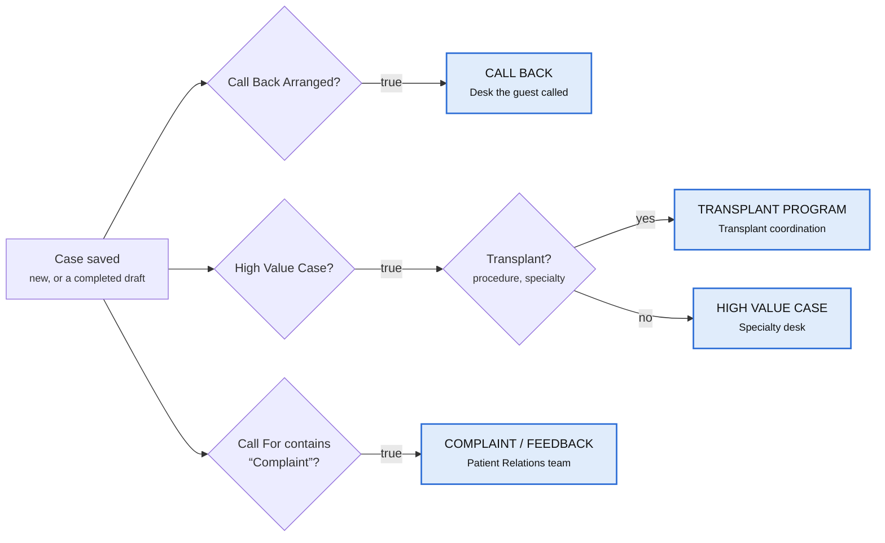

# Case WhatsApp Alerts — Workflow

When an agent saves a new case, the CRM checks four conditions and sends a WhatsApp alert to the right department for each one that matches. One case can match several conditions, and each match sends its own alert.

- **Fires on:** a new case being saved, or an Incomplete draft being completed. Ordinary edits to an existing case do not fire it.
- **Runs once per case:** a repeated save never sends the same alerts twice.
- **Where it lives:** Admin → Workflows → **+ Case WhatsApp Alerts**. It runs alongside the existing New Case Onboarding workflow and does not change it.

## Workflow graph



The three checks run independently, so a case can match more than one, up to three alerts. A case that fails every check sends nothing.

## Nodes

Each alert is a Send Notification node on the WhatsApp channel. Concern is the case summary the agent typed.

| Alert | Sent when | Recipient | Message fields |
| --- | --- | --- | --- |
| CALL BACK | Call Back Arranged = true | Desk the guest was trying to reach (e.g. Report Desk, Billing Desk) | Name, Number, Concern |
| HIGH VALUE CASE | High Value Case = true, not Transplant | Specialty desk for the procedure | Name, Number, Concern |
| TRANSPLANT PROGRAM | High Value Case = true and Procedure / Specialty Enquired contains "Transplant" | Transplant coordination team | Name, Number, Location (city, state), Concern |
| COMPLAINT / FEEDBACK | Call For contains "Complaint" | Patient Relations / Quality, plus the department named | Name, Number, Concern |

**Transplant check:** the case counts as Transplant if Type of Procedure, Name of Procedure or Specialty Enquired For contains "Transplant". A Transplant case gets the Transplant alert instead of the High Value alert, never both.

### Messages

```
CALL BACK
Name- {{contact.name}}
Number- {{contact.mobile}}
Concern- {{case.summary}}
Please arrange a call back from concerned department.
```

```
HIGH VALUE CASE
Name - {{contact.name}}
Number - {{contact.mobile}}
Concern- {{case.summary}}
Please arrange a call back from concerned department
```

```
Transplant Program
Name- {{contact.name}}
Number- {{contact.mobile}}
Location - {{contact.city}}, {{contact.state}}
Concern- {{case.summary}}
Please arrange a call back from concerned department.
```

```
Complaint/Feedback
Name- {{contact.name}}
Number- {{contact.mobile}}
Concern- {{case.summary}}
Please look into this matter.
```

## Meta WhatsApp templates

Alerts are business-initiated, so Meta only delivers them as **approved templates**. Plain text reaches a number only within 24 hours of it messaging the business number. Create these four in WhatsApp Manager → Message templates. Use category **Utility**, language **English (en)**, and these exact names. Each WhatsApp node fills `{{1}}`, `{{2}}`, … from its "Template values" field, one value per line.

| Template name | Body | Values |
| --- | --- | --- |
| `psri_call_back` | CALL BACK<br>Name- {{1}}<br>Number- {{2}}<br>Concern- {{3}}<br>Please arrange a call back from concerned department. | name, mobile, case summary |
| `psri_high_value_case` | HIGH VALUE CASE<br>Name - {{1}}<br>Number - {{2}}<br>Concern- {{3}}<br>Please arrange a call back from concerned department | name, mobile, case summary |
| `psri_transplant_program` | Transplant Program<br>Name- {{1}}<br>Number- {{2}}<br>Location - {{3}}<br>Concern- {{4}}<br>Please arrange a call back from concerned department. | name, mobile, "city, state", case summary |
| `psri_complaint_feedback` | Complaint/Feedback<br>Name- {{1}}<br>Number- {{2}}<br>Concern- {{3}}<br>Please look into this matter. | name, mobile, case summary |

Line breaks inside a value (e.g. a multi-line case summary) are sent as spaces, because Meta rejects them in template values.

**Credentials:** Meta app → WhatsApp → API Setup gives the **Phone number ID**. For production, use a permanent **System User token** with the `whatsapp_business_messaging` permission; the temporary token on that page expires in 24 hours. Put both in the `whatsapp` block of `PSRI/Workflows/php/config.php`, or set the `PSRI_WA_PHONE_NUMBER_ID` / `PSRI_WA_TOKEN` environment variables. Then check the credentials from `PSRI/Workflows/php/`:

```
php -d extension=openssl -d extension=curl api.php wa-test 9667224319
```

This sends Meta's pre-approved `hello_world` template. While the Meta app is in development mode, the recipient must be added under API Setup → "To" (up to 5 numbers).

## Sending to WhatsApp groups

An alert can go to a WhatsApp group as well as, or instead of, individual numbers. This needs the green-tick Official Business Account (PSRI has one). Groups must be created through the API; existing staff groups can't be used. Each group holds at most 8 people, who join with an invite link — the business can't add them directly. ([Meta Groups API](https://developers.facebook.com/documentation/business-messaging/whatsapp/groups))

From `PSRI/Workflows/php/`, with `X="-d extension=openssl -d extension=curl"`:

1. Create one group per department: `php $X api.php wa-group-create "PSRI Billing Desk" "Case alerts from the CRM"`
2. List the groups: `php $X api.php wa-groups`. For each group this prints its **To** value (`group:<GROUP_ID>`) and its **invite link**.
3. Send each invite link to that department's staff.
4. In the workflow designer, put the group's `group:<GROUP_ID>` in the alert's "To" field. Groups and numbers can be mixed, comma-separated.
5. Check a group: `php $X api.php wa-test group:<GROUP_ID>`

## Before go-live

The workflow is built and the routing has been tested, but no real WhatsApp message has been sent yet.

- [ ] Enter each department's WhatsApp number in the "To" field of its alert node. The workflow cannot be saved while any of the four is blank.
- [ ] Choose the WhatsApp provider and enter its URL, token and request format in the server settings (`whatsapp` block in `PSRI/Workflows/php/config.php`; format in `config.example.php`). Until then every alert is logged as failed.
- [ ] Check whether the provider requires these four messages to be pre-approved as templates.
- [ ] Confirm the exact "Complaint / Feedback" value in the Call For list. The check matches any value containing "Complaint".
- [ ] Decide whether High Value alerts should go to a different desk per specialty. That needs extra condition nodes.
